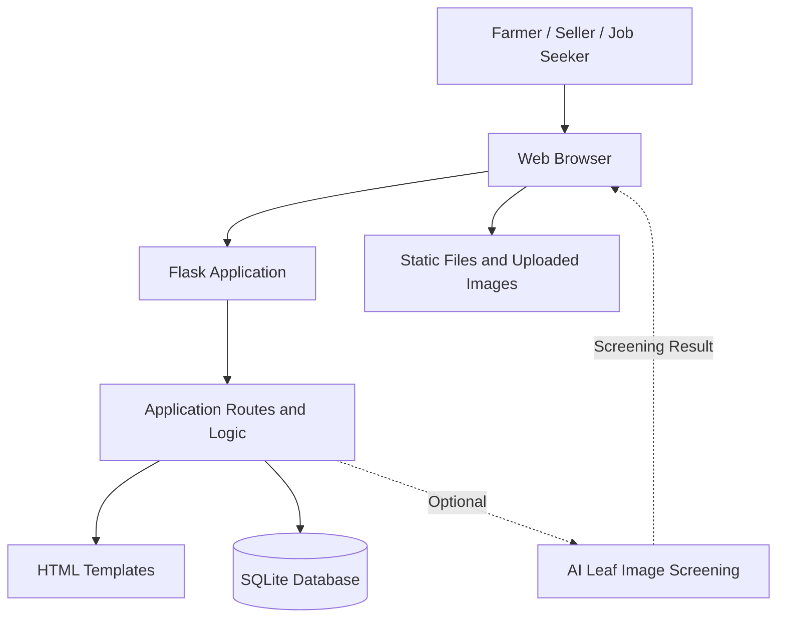

# GramSetu — Technical Design Document

## 1. Project Overview

GramSetu is a web-based platform designed to support rural development and livelihoods. It aims to connect farmers, local product sellers, women entrepreneurs, self-help groups (SHGs), and job seekers through a common digital platform.

## 2. Objectives

- Help farmers showcase available crops.
- Provide a marketplace for locally made rural products.
- Improve access to local employment opportunities.
- Provide access to farming information and experimental AI-based leaf screening where enabled.
- Support women entrepreneurs and rural livelihoods.

## 3. Technology Stack

- **Backend:** Python and Flask
- **Frontend:** HTML, CSS, JavaScript
- **Database:** SQLite
- **AI:** Optional image-classification component for leaf screening
- **Version Control:** Git and GitHub

## 4. System Architecture

### Component Description

- **Web Browser:** Allows users to access GramSetu and interact with its pages.
- **Flask Application:** Handles requests and application logic.
- **HTML Templates:** Display pages, forms, and listings.
- **SQLite Database:** Stores application records according to the implemented database schema.
- **Static Files:** Provide frontend assets and uploaded images where configured.
- **AI Screening:** An optional experimental feature that may analyze leaf images when its dependencies and model are configured.

## 5. Main Modules

### Farmer Marketplace
Supports crop listings with details such as crop name, quantity, price, location, contact information, and optional images.

### Rural Products Marketplace
Displays locally made products, including food products and handicrafts. It is intended to support rural producers, women entrepreneurs, and SHGs.

### Employment Module
Provides a place to display local job and work opportunities.

### Smart Farming Module
Provides farming information and may include experimental leaf-image screening. Screening results should be verified by qualified agricultural experts.

## 6. General Data Flow

1. A user opens GramSetu in a browser.
2. The browser sends a request to the Flask application.
3. Flask processes the request and renders the appropriate page.
4. When a user submits a listing, the application processes the submitted information.
5. The application stores and retrieves records using SQLite where implemented.
6. The browser displays the resulting page or listing.

## 7. Data Storage

The local prototype uses SQLite, according to its current configuration. Uploaded images may be stored in a configured directory.

The actual database schema, upload paths, validation rules, and routes are defined by the implementation in the repository and should be checked before deployment.

## 8. Security and Privacy Considerations

Before public deployment, review:

- Validation of submitted form data.
- File type and file size restrictions for uploaded images.
- Authorization for listing-management actions.
- Secure handling of PINs and credentials.
- Protection of secrets and private information.
- Privacy of user-submitted contact details.
- Database and uploaded-file backups.
- Production configuration with debugging disabled.

Only describe a security control as implemented after verifying it in the source code.

## 9. Deployment Considerations

The deployment environment should support the Flask application and its dependencies.

Before deployment:

1. Confirm the dependency list.
2. Back up the database and uploaded images.
3. Configure persistent storage if the host uses a temporary filesystem.
4. Keep credentials out of the public repository.
5. Disable debug mode in production.
6. Test the live application after deployment.

## 10. Limitations

- User-submitted listings and opportunities may not be independently verified.
- AI leaf screening may be inaccurate and is not a definitive diagnosis.
- Security, privacy, usability, and scalability require testing before production use.
- Feature availability depends on the current implementation and configuration.

## 11. Future Improvements

- Automated testing for application routes and forms.
- Stronger upload validation and security protections.
- Improved privacy and user authentication where needed.
- Persistent production storage and backup procedures.
- Usability testing with rural communities.
